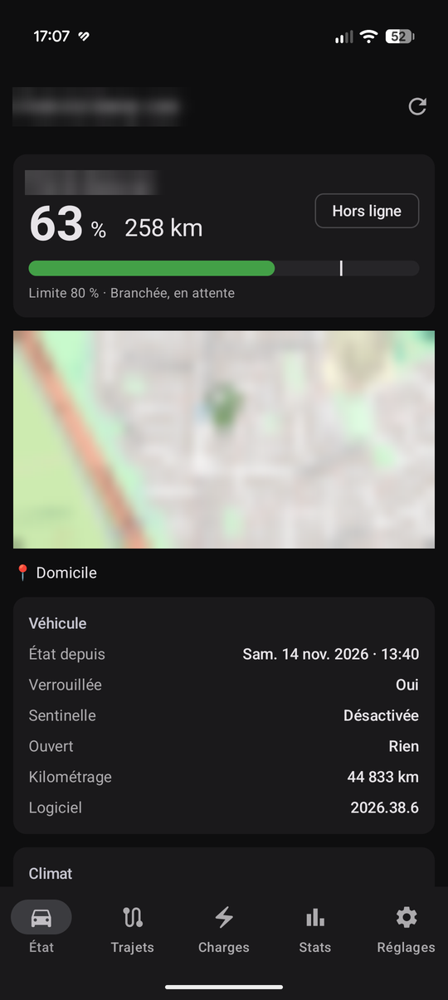
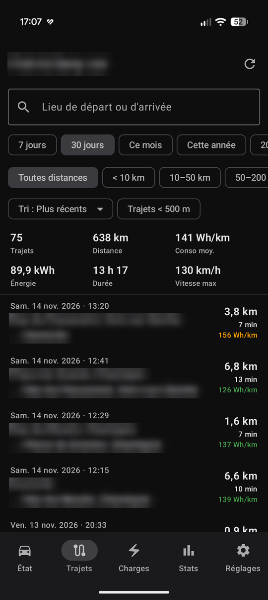

# MyTeslamateApiMobile

Appli Android perso pour consulter et **filtrer** ses données TeslaMate via la [TeslaMate API](https://github.com/tobiasehlert/teslamateapi) (hébergée par MyTeslaMate ou auto-hébergée).

- **État** : batterie, autonomie, charge en cours, position (OpenStreetMap), portes, sentinelle, pneus, santé batterie.
- **Trajets** : recherche par lieu, période (raccourcis ou dates au choix), distance, tri ; totaux et conso moyenne de la sélection ; détail avec tracé, vitesse, puissance, altitude.
- **Charges** : lieu (raccourcis vers les plus fréquents), période, AC/DC, payantes ; énergie, coût, prix moyen au kWh ; détail avec courbe de puissance.
- **Stats** : par mois ou par année : distance, énergie, coût, conso ; destinations et lieux de charge fréquents.
  **Calendrier** d'activité façon GitHub (km parcourus ou kWh chargés par jour) : toucher un jour ouvre ses trajets ou ses charges.

  
  
  
  

Synchronisation : tout l'historique au premier démarrage (gardé sur le téléphone), puis seulement les nouveautés à chaque ouverture.

## Installation

[Dernier APK](https://github.com/florianfish/MyTeslamateApiMobile/releases/download/debug/MyTeslamateApiMobile-debug.apk), puis dans **Réglages** :
- **Adresse** : celle de la TeslaMate API (MyTeslaMate › Services › TeslaMate API), ex. `https://xxxx.api.myteslamate.com`
- **Identifiant + mot de passe** (MyTeslaMate) ou **jeton** (instance auto-hébergée avec `API_TOKEN`).

## Compilation

Gradle 9.9.1, JDK 17 : `gradle assembleDebug`. CI via [Forge-Apk](https://github.com/florianfish/Forge-Apk).
