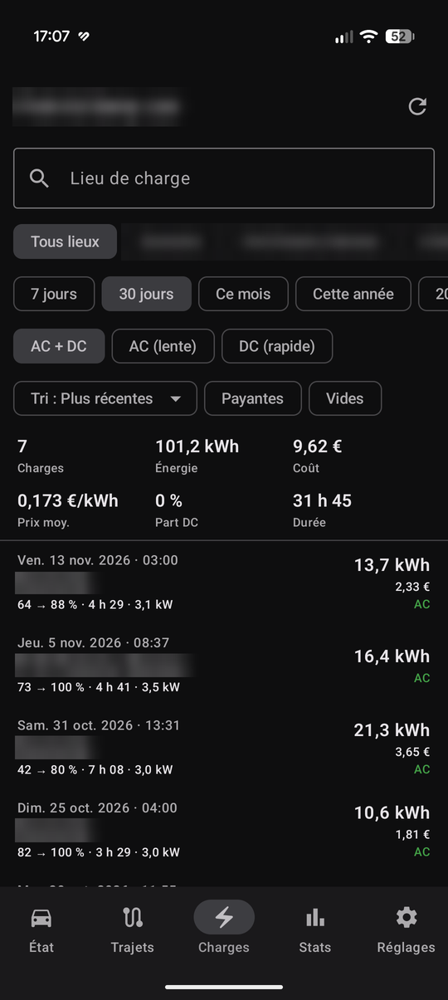
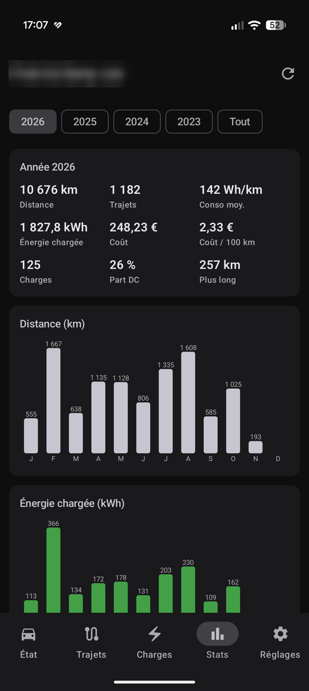

# MyTeslamateApiMobile

Appli Android perso pour consulter et **filtrer** ses données TeslaMate via la [TeslaMate API](https://github.com/tobiasehlert/teslamateapi).

Elle fonctionne avec **n'importe quelle instance TeslaMate couplée à TeslaMate API** : la vôtre, auto-hébergée, ou celle fournie par un service comme [MyTeslaMate](https://www.myteslamate.com). L'appli ne parle qu'à la TeslaMate API (lecture seule) : elle ne se connecte ni à TeslaMate directement, ni à Tesla.

- **État** : batterie, autonomie, charge en cours, position (OpenStreetMap), portes, sentinelle, pneus, santé batterie.
- **Trajets** : recherche par lieu, période (raccourcis ou dates au choix), distance, tri ; totaux et conso moyenne de la sélection ; détail avec tracé, vitesse, puissance, altitude.
- **Charges** : lieu (raccourcis vers les plus fréquents), période, AC/DC, payantes ; énergie, coût, prix moyen au kWh ; détail avec courbe de puissance.
- **Stats** : par mois ou par année : distance, énergie, coût, conso ; destinations et lieux de charge fréquents.

  
  
  
  

Synchronisation : tout l'historique au premier démarrage (gardé sur le téléphone), puis seulement les nouveautés à chaque ouverture.

## Prérequis

- Une instance [TeslaMate](https://github.com/teslamate-org/teslamate) avec [TeslaMate API](https://github.com/tobiasehlert/teslamateapi) branchée dessus.
- La TeslaMate API joignable depuis le téléphone **en HTTPS** (reverse proxy, VPN…) : l'appli refuse les adresses `http://`.
- Une authentification : jeton (`API_TOKEN` de TeslaMate API) ou identifiant + mot de passe (Basic, par ex. derrière un reverse proxy ou chez MyTeslaMate).

## Installation

[Dernier APK](https://github.com/florianfish/MyTeslamateApiMobile/releases/download/debug/MyTeslamateApiMobile-debug.apk), puis dans **Réglages** :

- **Adresse** : la racine de votre TeslaMate API, sans `/api/v1` (l'appli l'ajoute).
  - Auto-hébergée : par ex. `https://teslamateapi.mondomaine.fr`
  - MyTeslaMate : MyTeslaMate › Services › TeslaMate API, par ex. `https://xxxx.api.myteslamate.com`
- **Authentification** :
  - **Jeton (Bearer)** : la valeur d'`API_TOKEN` configurée dans TeslaMate API.
  - **Identifiant + mot de passe** (Basic) : ceux de votre reverse proxy, ou de MyTeslaMate. Identifiant vide = sous-domaine de l'adresse (pratique pour MyTeslaMate).
- **Tester**, puis **Enregistrer**. Le mot de passe / jeton est chiffré sur le téléphone (Keystore Android).

## Compilation

Gradle 9.9.1, JDK 17 : `gradle assembleDebug`. CI via [Forge-Apk](https://github.com/florianfish/Forge-Apk).
